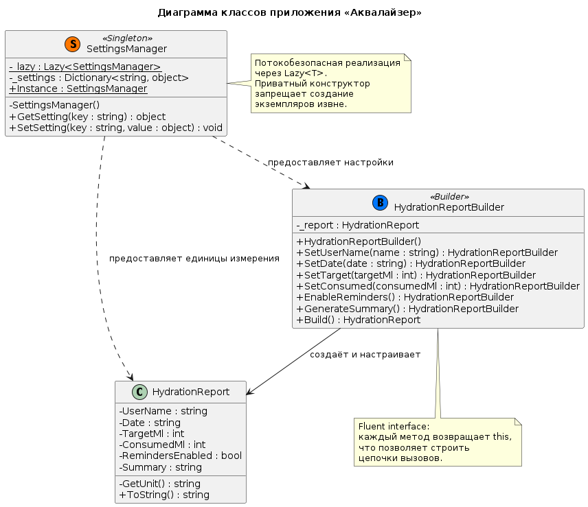
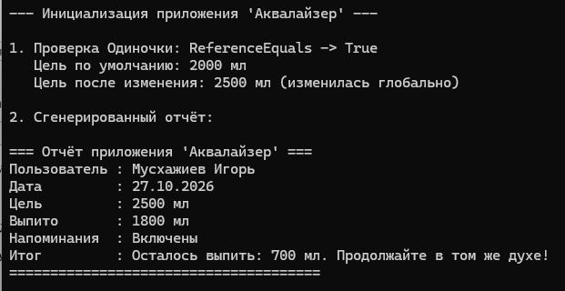

# Министерство науки и высшего образования Российской Федерации

**Федеральное государственное автономное образовательное учреждение высшего образования**  
«СЕВЕРО-КАВКАЗСКИЙ ФЕДЕРАЛЬНЫЙ УНИВЕРСИТЕТ»

**Институт информационных технологий и кибербезопасности**  
**Межинститутская базовая кафедра**

**Дисциплина:** Паттерны проектирования

## ОТЧЕТ ПО ЛАБОРАТОРНОЙ РАБОТЕ №1

**Тема:** Порождающие паттерны: одиночка, строитель

| | |
| :--- | :--- |
| **Выполнил:** | Мусхажиев Игорь Александрович 4 курс, группа ПИЖ-б-о-23-2(2) 09.03.04 «Программная инженерия», очная форма обучения _____________________________ (подпись) |
| **Проверил:** | ассистент МБК ИИТиКБ Белик А. И. _____________________________ (подпись) |

**Отчет защищен с оценкой:** ___________  
**Дата защиты:** __________________

**Ставрополь, 2026 г.**

---

### Цель работы
Получить практические навыки применения порождающих паттернов проектирования для решения прикладных задач на языке программирования высокого уровня.

## 1. Теоретическое обоснование

Согласно классификации паттернов проектирования (Гамма Э. и др.), порождающие паттерны регулируют способы создания объектов, скрывая логику их инициализации. В данной работе применены два паттерна:

*   **Одиночка (Singleton)** – гарантирует, что у класса есть только один экземпляр, и предоставляет к нему глобальную точку доступа. В приложении «Аквалайзер» этот паттерн используется для класса `SettingsManager`, который хранит глобальные настройки (дневная цель в мл, интервал напоминаний, единицы измерения). Это предотвращает рассинхронизацию состояния и экономит ресурсы памяти.
*   **Строитель (Builder)** – позволяет собирать сложные объекты пошагово. В приложении этот паттерн реализован в классе `HydrationReportBuilder` для поэтапного формирования отчета о гидратации. Использование паттерна позволяет избежать «телескопического конструктора» с множеством параметров и реализует удобный *Fluent Interface* (цепочку вызовов).

## 2. Проектирование и реализация

**Вариант 7:** Разработка приложения «Аквалайзер».

**Постановка задачи:** Реализовать приложение для отслеживания и управления балансом потребления воды (гидратации) с обязательным использованием паттернов проектирования «Одиночка» (Singleton) и «Строитель» (Builder).

### 2.1. Диаграмма классов (UML)

Реализация паттернов подтверждается следующей диаграммой классов в нотации UML:

> *Рисунок 1 – Диаграмма классов*
> 

### 2.2. Исходный код

Полный исходный код также доступен в репозитории GitHub: [https://github.com/Igoremys/Aqualyzer.git](https://github.com/Igoremys/Aqualyzer.git)

> *Рисунок 2 – Результат работы программы*
> 

## Вывод

В ходе выполнения лабораторной работы была успешно решена прикладная задача варианта 7 на языке C#.

В процессе разработки были изучены и практически применены порождающие паттерны проектирования:

1.  **Паттерн Одиночка (Singleton)** был реализован с использованием `Lazy<T>`, что обеспечило потокобезопасность, ленивую инициализацию и гарантировало единственность экземпляра класса настроек во всем приложении.
2.  **Паттерн Строитель (Builder)** был реализован с применением *Fluent Interface*, что позволило пошагово и читаемо конструировать сложный объект отчета, избегая перегруженных конструкторов.
