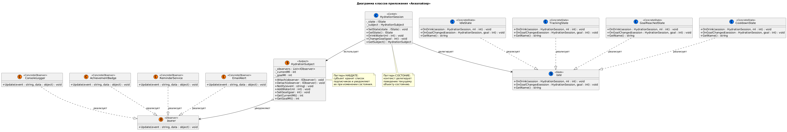
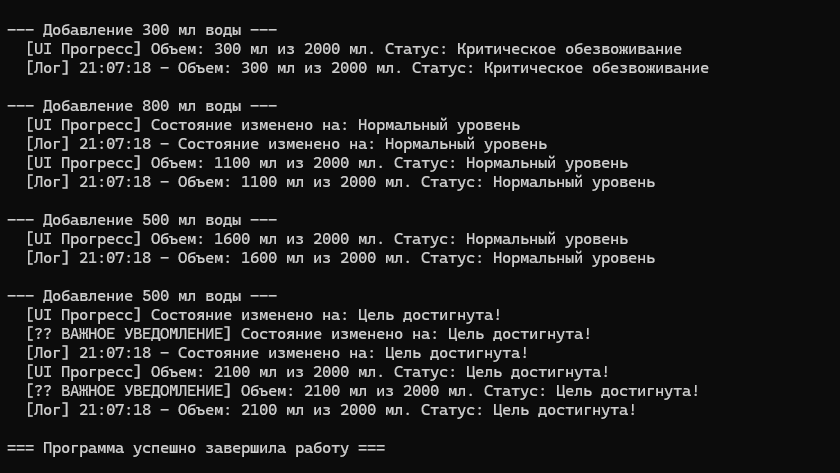

# Министерство науки и высшего образования Российской Федерации

**Федеральное государственное автономное образовательное учреждение высшего образования**  
«СЕВЕРО-КАВКАЗСКИЙ ФЕДЕРАЛЬНЫЙ УНИВЕРСИТЕТ»

**Институт информационных технологий и кибербезопасности**  
**Межинститутская базовая кафедра**

**Дисциплина:** Паттерны проектирования

## ОТЧЕТ ПО ЛАБОРАТОРНОЙ РАБОТЕ №10

**Тема:** Поведенческие паттерны: Наблюдатель, Состояние

| | |
| :--- | :--- |
| **Выполнил:** | Мусхажиев Игорь Александрович 4 курс, группа ПИЖ-б-о-23-2(2) 09.03.04 «Программная инженерия», очная форма обучения _____________________________ (подпись) |
| **Проверил:** | ассистент МБК ИИТиКБ Белик А. И. _____________________________ (подпись) |

**Отчет защищен с оценкой:** ___________  
**Дата защиты:** __________________

**Ставрополь, 2026 г.**

---

### Цель работы
Получить практические навыки применения поведенческих паттернов проектирования для организации механизма подписки/оповещения и динамического изменения поведения объекта при смене его внутреннего состояния на языке программирования высокого уровня.

## 1. Теоретическое обоснование
Наблюдатель (Observer) – создаёт механизм подписки, при котором один объект (субъект) уведомляет множество зависимых объектов (наблюдателей) об изменениях своего состояния. В «Аквалайзере» субъектом является HydrationSubject, хранящий текущий объём выпитой воды и дневную цель. Наблюдателями выступают ConsoleLogger (логирование), AchievementBadge (выдача достижений), ReminderService (напоминания) и EmailAlert (email-уведомления). При изменении состояния субъекта все подписчики автоматически получают уведомление, при этом субъект ничего не знает о конкретных классах наблюдателей.
Состояние (State) – позволяет объекту менять своё поведение в зависимости от внутреннего состояния, как будто бы он меняет свой класс. В приложении контекстом является HydrationSession (сессия пользователя), а состояниями — IdleState (ожидание), TrackingState (активный трекинг), GoalReachedState (цель достигнута) и CooldownState (отдых после достижения цели). Метод DrinkWater() ведёт себя по-разному в каждом состоянии: в Idle он запускает трекинг, в Tracking — проверяет достижение цели, в GoalReached — не увеличивает счётчик, а переводит в Cooldown.

## 2. Проектирование и реализация

**Вариант 7:** Разработка приложения «Аквалайзер».

**Постановка задачи:**  Реализовать систему оповещения подписчиков об изменениях состояния гидратации пользователя и механизм смены поведения сессии в зависимости от её состояния (ожидание, активный трекинг, достижение цели, отдых), с обязательным использованием паттернов «Наблюдатель» (Observer) и «Состояние» (State).

### 2.1. Диаграмма классов (UML)

Реализация паттернов подтверждается следующей диаграммой классов в нотации UML:

> *Рисунок 1 – Диаграмма классов*
> 

### 2.2. Исходный код

Полный исходный код также доступен в репозитории GitHub: [https://github.com/Igoremys/Aqualyzer.git](https://github.com/Igoremys/Aqualyzer.git)

> *Рисунок 2 – Результат работы программы*
> 

## Вывод

В ходе выполнения лабораторной работы № 10 было расширено приложение «Аквалайзер» (Вариант 7) на языке C# с применением двух поведенческих паттернов проектирования:
Наблюдатель (Observer) обеспечил механизм оповещения подписчиков об изменениях состояния гидратации. Благодаря этому:
субъект HydrationSubject ничего не знает о конкретных классах наблюдателей, что соблюдает принцип инверсии зависимостей (DIP);
новые подписчики (например, SmsAlert, WearableSync) добавляются простым вызовом Attach() без изменения кода субъекта (принцип Open/Closed);
при достижении цели одновременно срабатывают логгер, выдача медали, напоминание и email-уведомление.
Состояние (State) позволило моделировать жизненный цикл сессии пользователя. Благодаря этому:
поведение метода DrinkWater() полностью меняется в зависимости от текущего состояния (Idle, Tracking, GoalReached, Cooldown);
код каждого состояния изолирован в отдельном классе, что устраняет громоздкие switch/if-else в контексте;
переходы между состояниями управляются самими объектами-состояниями, что делает логику прозрачной и расширяемой.