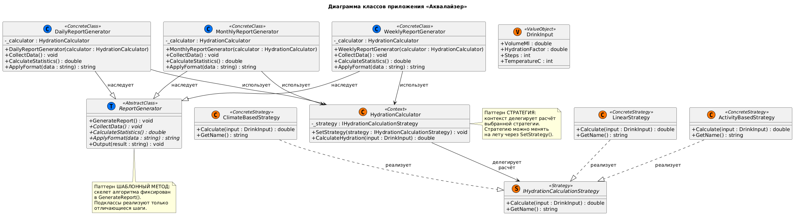
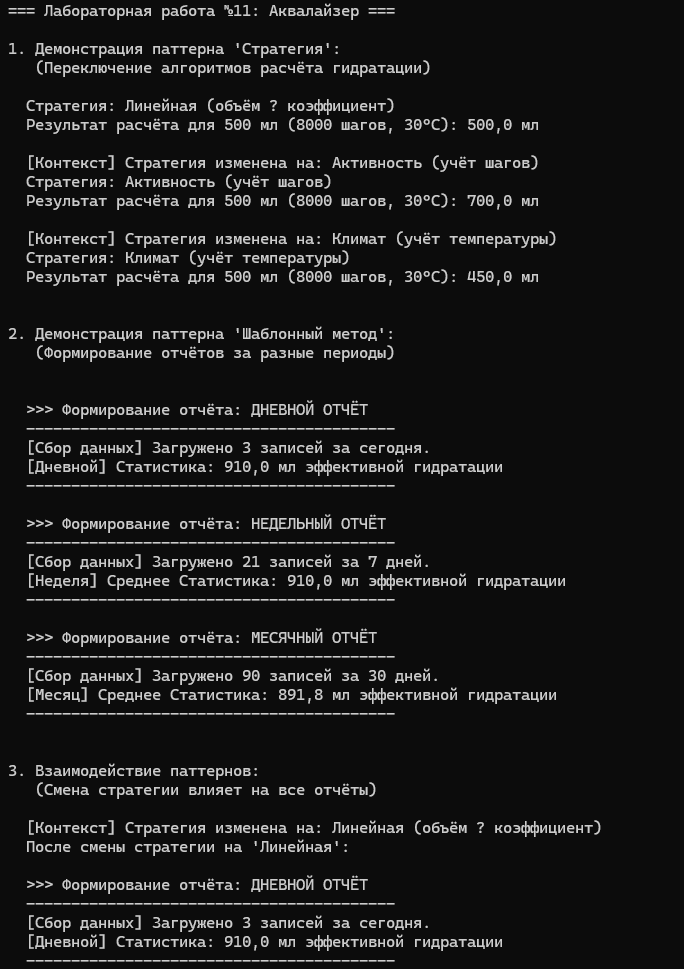

# Министерство науки и высшего образования Российской Федерации

**Федеральное государственное автономное образовательное учреждение высшего образования**  
«СЕВЕРО-КАВКАЗСКИЙ ФЕДЕРАЛЬНЫЙ УНИВЕРСИТЕТ»

**Институт информационных технологий и кибербезопасности**  
**Межинститутская базовая кафедра**

**Дисциплина:** Паттерны проектирования

## ОТЧЕТ ПО ЛАБОРАТОРНОЙ РАБОТЕ №11

**Тема:** Поведенческие паттерны: Стратегия, Шаблонный метод

| | |
| :--- | :--- |
| **Выполнил:** | Мусхажиев Игорь Александрович 4 курс, группа ПИЖ-б-о-23-2(2) 09.03.04 «Программная инженерия», очная форма обучения _____________________________ (подпись) |
| **Проверил:** | ассистент МБК ИИТиКБ Белик А. И. _____________________________ (подпись) |

**Отчет защищен с оценкой:** ___________  
**Дата защиты:** __________________

**Ставрополь, 2026 г.**

---

### Цель работы
Получить практические навыки применения поведенческих паттернов проектирования для инкапсуляции семейства алгоритмов (Стратегия) и определения скелета алгоритма с отложенной реализацией шагов в подклассах (Шаблонный метод) на языке программирования высокого уровня.

## 1. Теоретическое обоснование
Стратегия (Strategy) – инкапсулирует семейство алгоритмов в отдельные классы и делает их взаимозаменяемыми. В «Аквалайзере» этот паттерн применяется для расчёта эффективной гидратации: LinearStrategy (простая формула «объём × коэффициент напитка»), ActivityBasedStrategy (учитывает шаги и физическую нагрузку), ClimateBasedStrategy (учитывает температуру и влажность воздуха). Клиентский код может переключать стратегию в любой момент, не зная внутренней реализации алгоритма.
Шаблонный метод (Template Method) – задаёт скелет алгоритма в абстрактном классе, оставляя реализацию некоторых шагов подклассам. В приложении паттерн реализован для формирования отчётов: абстрактный класс ReportGenerator определяет последовательность шагов (сбор данных → расчёт статистики → применение формата → вывод), а конкретные подклассы DailyReportGenerator, WeeklyReportGenerator, MonthlyReportGenerator реализуют только отличающиеся шаги (например, период выборки данных).

## 2. Проектирование и реализация

**Вариант 7:** Разработка приложения «Аквалайзер».

**Постановка задачи:**  Реализовать механизм динамического переключения алгоритмов расчёта эффективной гидратации пользователя и механизм формирования отчётов о гидратации за различные периоды с общей структурой алгоритма, с обязательным использованием паттернов «Стратегия» (Strategy) и «Шаблонный метод» (Template Method).

### 2.1. Диаграмма классов (UML)

Реализация паттернов подтверждается следующей диаграммой классов в нотации UML:

> *Рисунок 1 – Диаграмма классов*
> 

### 2.2. Исходный код

Полный исходный код также доступен в репозитории GitHub: [https://github.com/Igoremys/Aqualyzer.git](https://github.com/Igoremys/Aqualyzer.git)

> *Рисунок 2 – Результат работы программы*
> 

## Вывод

В ходе выполнения лабораторной работы № 11 было расширено приложение «Аквалайзер» (Вариант 7) на языке C# с применением двух поведенческих паттернов проектирования:
Стратегия (Strategy) позволила инкапсулировать семейство алгоритмов расчёта эффективной гидратации в отдельные классы (LinearStrategy, ActivityBasedStrategy, ClimateBasedStrategy). Благодаря этому:
контекст HydrationCalculator не знает о конкретной реализации алгоритма и работает только через интерфейс IHydrationCalculationStrategy;
стратегию можно переключать на лету методом SetStrategy() без изменения клиентского кода;
добавление нового алгоритма (например, AgeBasedStrategy) требует только создания нового класса, реализующего интерфейс (принцип Open/Closed).
Шаблонный метод (Template Method) задал единый скелет алгоритма формирования отчёта (GenerateReport()), а конкретные шаги (CollectData, CalculateStatistics, ApplyFormat) реализованы в подклассах. Благодаря этому:
общая структура отчёта гарантированно одинакова для дневного, недельного и месячного вариантов;
подклассы отвечают только за свою специфику (период выборки, формат вывода);
при изменении структуры отчёта достаточно изменить шаблонный метод в одном месте — все подклассы автоматически получат новую последовательность.