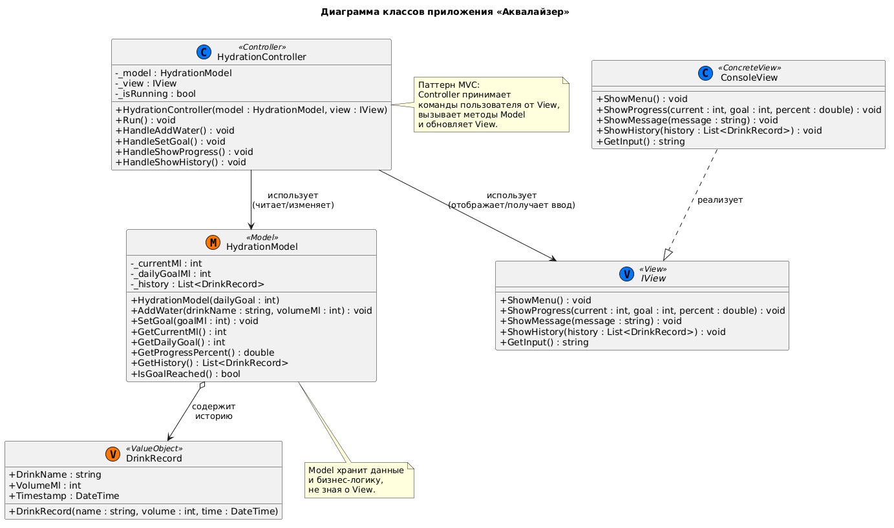
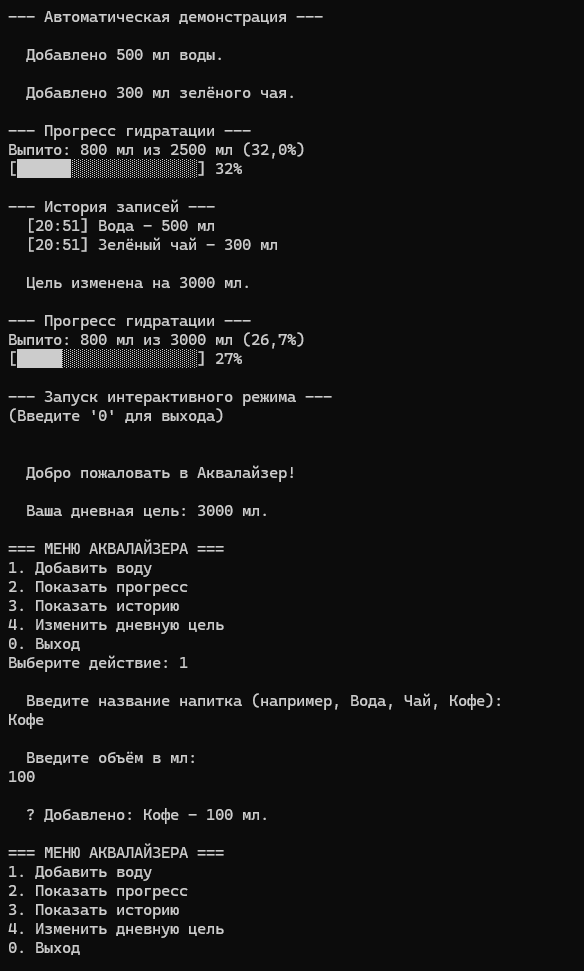

# Министерство науки и высшего образования Российской Федерации

**Федеральное государственное автономное образовательное учреждение высшего образования**  
«СЕВЕРО-КАВКАЗСКИЙ ФЕДЕРАЛЬНЫЙ УНИВЕРСИТЕТ»

**Институт информационных технологий и кибербезопасности**  
**Межинститутская базовая кафедра**

**Дисциплина:** Паттерны проектирования

## ОТЧЕТ ПО ЛАБОРАТОРНОЙ РАБОТЕ №12

**Тема:** Архитектурные паттерны: MVC

| | |
| :--- | :--- |
| **Выполнил:** | Мусхажиев Игорь Александрович 4 курс, группа ПИЖ-б-о-23-2(2) 09.03.04 «Программная инженерия», очная форма обучения _____________________________ (подпись) |
| **Проверил:** | ассистент МБК ИИТиКБ Белик А. И. _____________________________ (подпись) |

**Отчет защищен с оценкой:** ___________  
**Дата защиты:** __________________

**Ставрополь, 2026 г.**

---

### Цель работы
Получить практические навыки применения архитектурных паттернов проектирования для организации структуры приложения с чётким разделением ответственности между слоями на языке программирования высокого уровня.

## 1. Теоретическое обоснование
MVC (Model-View-Controller) — это архитектурный паттерн, который разделяет приложение на три взаимосвязанных компонента:
Model (Модель) — хранит данные приложения и реализует бизнес-логику. В «Аквалайзере» это класс HydrationModel, который хранит текущий объём выпитой воды, дневную цель, историю записей и предоставляет методы для их изменения (AddWater, SetGoal, GetProgressPercent). Модель ничего не знает о том, как данные будут отображаться.
View (Представление) — отвечает за отображение данных пользователю и получение от него ввода. В нашем случае это ConsoleView, который выводит прогресс-бар, меню и сообщения, а также считывает команды пользователя. View не содержит бизнес-логики.
Controller (Контроллер) — выступает посредником между Model и View. Он принимает команды от View (например, «добавить 300 мл воды»), вызывает соответствующие методы Model и передаёт результаты обратно в View для отображения.

## 2. Проектирование и реализация

**Вариант 7:** Разработка приложения «Аквалайзер».

**Постановка задачи:**  Реализовать приложение для отслеживания потребления воды с использованием архитектурного паттерна MVC (Model-View-Controller), разделив приложение на три независимых слоя: модель (данные и бизнес-логика), представление (интерфейс пользователя) и контроллер (логика управления).

### 2.1. Диаграмма классов (UML)

Реализация паттернов подтверждается следующей диаграммой классов в нотации UML:

> *Рисунок 1 – Диаграмма классов*
> 

### 2.2. Исходный код

Полный исходный код также доступен в репозитории GitHub: [https://github.com/Igoremys/Aqualyzer.git](https://github.com/Igoremys/Aqualyzer.git)

> *Рисунок 2 – Результат работы программы*
> 

## Вывод

В ходе выполнения лабораторной работы № 12 было разработано приложение «Аквалайзер» (Вариант 7) на языке C# с применением архитектурного паттерна MVC (Model-View-Controller).
В рамках работы были решены следующие задачи:
Разделение ответственности: приложение чётко разделено на три слоя:
Model (HydrationModel) — хранит данные (текущий объём, цель, историю) и реализует бизнес-логику (добавление воды, расчёт процента, проверка достижения цели). Модель не зависит от способа отображения.
View (ConsoleView) — отвечает за вывод информации пользователю (меню, прогресс-бар, история) и получение ввода. View не содержит бизнес-логики.
Controller (HydrationController) — принимает команды от пользователя через View, вызывает соответствующие методы Model и передаёт результаты обратно в View.
Гибкость и расширяемость: благодаря разделению слоёв, можно легко заменить консольный View на графический (например, WPF или WinForms) без изменения Model и Controller. Аналогично, бизнес-логику в Model можно усложнять (добавить расчёт калорий, интеграцию с фитнес-трекером) без влияния на интерфейс.
Тестируемость: Model можно тестировать независимо от UI, что соответствует принципам модульного тестирования.