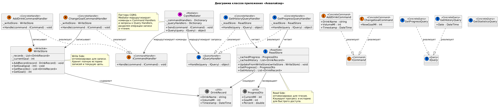
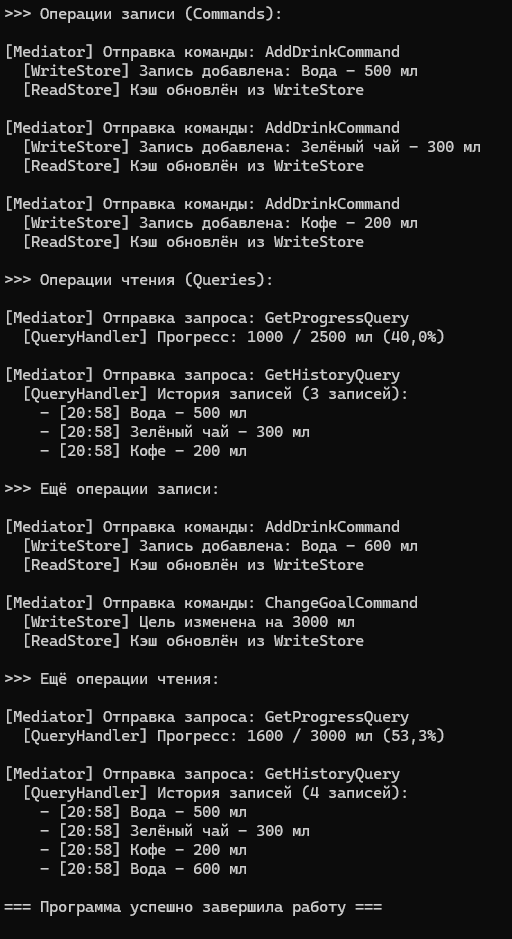

# Министерство науки и высшего образования Российской Федерации

**Федеральное государственное автономное образовательное учреждение высшего образования**  
«СЕВЕРО-КАВКАЗСКИЙ ФЕДЕРАЛЬНЫЙ УНИВЕРСИТЕТ»

**Институт информационных технологий и кибербезопасности**  
**Межинститутская базовая кафедра**

**Дисциплина:** Паттерны проектирования

## ОТЧЕТ ПО ЛАБОРАТОРНОЙ РАБОТЕ №13

**Тема:** Паттерны микросервисов и распределённых систем: CQRS

| | |
| :--- | :--- |
| **Выполнил:** | Мусхажиев Игорь Александрович 4 курс, группа ПИЖ-б-о-23-2(2) 09.03.04 «Программная инженерия», очная форма обучения _____________________________ (подпись) |
| **Проверил:** | ассистент МБК ИИТиКБ Белик А. И. _____________________________ (подпись) |

**Отчет защищен с оценкой:** ___________  
**Дата защиты:** __________________

**Ставрополь, 2026 г.**

---

### Цель работы
Получить практические навыки применения паттернов микросервисов и распределённых систем для разделения ответственности между операциями чтения и записи данных на языке программирования высокого уровня.

## 1. Теоретическое обоснование
CQRS (Command Query Responsibility Segregation) — это архитектурный паттерн, который разделяет операции изменения состояния системы (Commands) и операции получения данных (Queries) на уровне моделей, обработчиков и даже хранилищ данных.
В классической архитектуре одна и та же модель используется и для чтения, и для записи. В CQRS же:
Command (Команда) — описывает намерение изменить состояние системы (например, AddDrinkCommand, ChangeGoalCommand). Команды не возвращают данные, только результат выполнения (успех/ошибка).
Query (Запрос) — описывает намерение получить данные (например, GetProgressQuery, GetHistoryQuery). Запросы не изменяют состояние системы.
Command Handler — обрабатывает команды, изменяет состояние и сохраняет его.
Query Handler — обрабатывает запросы, читает данные из оптимизированного хранилища.

## 2. Проектирование и реализация

**Вариант 7:** Разработка приложения «Аквалайзер».

**Постановка задачи:**  Реализовать приложение для отслеживания потребления воды с применением паттерна CQRS (Command Query Responsibility Segregation), разделив операции записи (добавление записей о напитках, изменение цели) и операции чтения (получение статистики, истории, прогресса) на уровне моделей и обработчиков.

### 2.1. Диаграмма классов (UML)

Реализация паттернов подтверждается следующей диаграммой классов в нотации UML:

> *Рисунок 1 – Диаграмма классов*
> 

### 2.2. Исходный код

Полный исходный код также доступен в репозитории GitHub: [https://github.com/Igoremys/Aqualyzer.git](https://github.com/Igoremys/Aqualyzer.git)

> *Рисунок 2 – Результат работы программы*
> 

## Вывод

В ходе выполнения лабораторной работы № 13 было разработано приложение «Аквалайзер» (Вариант 7) на языке C# с применением паттерна микросервисов и распределённых систем CQRS (Command Query Responsibility Segregation).
В рамках работы были решены следующие задачи:
Разделение операций записи и чтения: приложение чётко разделено на два независимых слоя:
Write Side (WriteStore) — оптимизирован для операций записи (добавление записей о напитках, изменение цели). Хранит полную историю изменений.
Read Side (ReadStore) — оптимизирован для операций чтения (получение прогресса, истории). Кэширует данные для быстрого доступа.
Команды и запросы: все операции инкапсулированы в объекты:
Commands (AddDrinkCommand, ChangeGoalCommand) — описывают намерение изменить состояние. Не возвращают данные.
Queries (GetProgressQuery, GetHistoryQuery) — описывают намерение получить данные. Не изменяют состояние.
Обработчики и Mediator: для каждой команды и запроса создан отдельный обработчик (CommandHandler, QueryHandler). Посредник CqrsMediator маршрутизирует команды и запросы к соответствующим обработчикам, что делает архитектуру расширяемой и тестируемой.
Синхронизация хранилищ: после каждой операции записи ReadStore обновляется из WriteStore, обеспечивая консистентность данных. В реальном микросервисном приложении эта синхронизация могла бы происходить асинхронно через события (Event Sourcing).