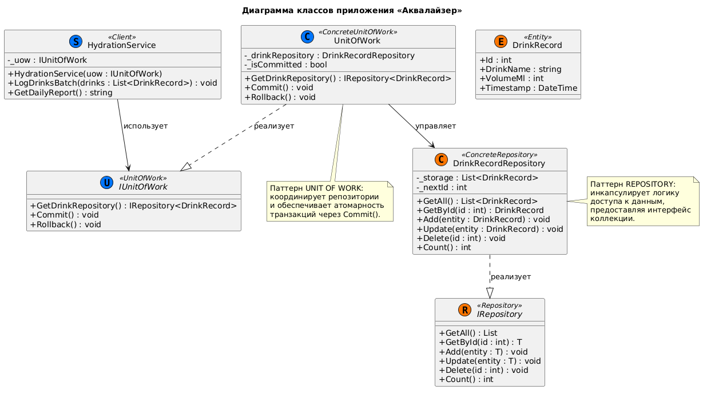
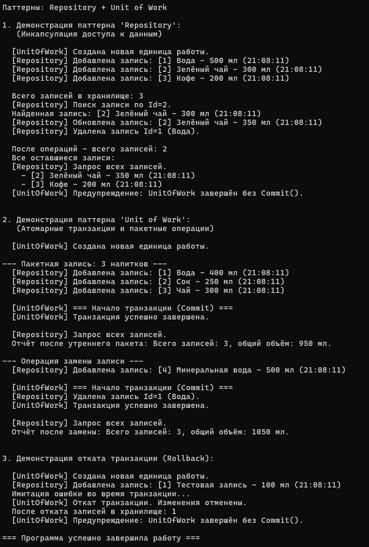

# Министерство науки и высшего образования Российской Федерации

**Федеральное государственное автономное образовательное учреждение высшего образования**  
«СЕВЕРО-КАВКАЗСКИЙ ФЕДЕРАЛЬНЫЙ УНИВЕРСИТЕТ»

**Институт информационных технологий и кибербезопасности**  
**Межинститутская базовая кафедра**

**Дисциплина:** Паттерны проектирования

## ОТЧЕТ ПО ЛАБОРАТОРНОЙ РАБОТЕ №14

**Тема:** Системные паттерны и работа с данными: Repository, Unit of Work

| | |
| :--- | :--- |
| **Выполнил:** | Мусхажиев Игорь Александрович 4 курс, группа ПИЖ-б-о-23-2(2) 09.03.04 «Программная инженерия», очная форма обучения _____________________________ (подпись) |
| **Проверил:** | ассистент МБК ИИТиКБ Белик А. И. _____________________________ (подпись) |

**Отчет защищен с оценкой:** ___________  
**Дата защиты:** __________________

**Ставрополь, 2026 г.**

---

### Цель работы
Получить практические навыки применения системных паттернов проектирования для организации слоя доступа к данным, отделения бизнес-логики от механизмов хранения и обеспечения атомарности транзакций на языке программирования высокого уровня.

## 1. Теоретическое обоснование
В данной работе применены два системных паттерна:
Repository (Репозиторий) – посредник между слоем бизнес-логики и слоем данных, имитирующий коллекцию объектов в памяти. Репозиторий инкапсулирует логику хранения, поиска и удаления записей, предоставляя клиентскому коду простой и понятный интерфейс. В приложении «Аквалайзер» репозиторий DrinkRecordRepository работает с записями о потреблении напитков, скрывая от бизнес-логики детали их хранения (в демо-версии — в памяти, в реальном приложении — в базе данных).
Unit of Work (Единица работы) – отслеживает все изменения объектов в рамках одной бизнес-транзакции и сохраняет их в хранилище одним пакетом. Это гарантирует атомарность операций: либо все изменения сохраняются успешно, ни одно из них не применяется в случае ошибки. В приложении UnitOfWork координирует несколько репозиториев (например, репозиторий записей и репозиторий целей) и предоставляет метод Commit() для единовременного сохранения всех изменений.

## 2. Проектирование и реализация

**Вариант 7:** Разработка приложения «Аквалайзер».

**Постановка задачи:**  Реализовать слой доступа к данным приложения «Аквалайзер» с использованием паттернов Repository (для инкапсуляции операций CRUD над записями о потреблении воды) и Unit of Work (для группировки нескольких операций в единую транзакцию)

### 2.1. Диаграмма классов (UML)

Реализация паттернов подтверждается следующей диаграммой классов в нотации UML:

> *Рисунок 1 – Диаграмма классов*
> 

### 2.2. Исходный код

Полный исходный код также доступен в репозитории GitHub: [https://github.com/Igoremys/Aqualyzer.git](https://github.com/Igoremys/Aqualyzer.git)

> *Рисунок 2 – Результат работы программы*
> 

## Вывод

В ходе выполнения лабораторной работы № 14 было расширено приложение «Аквалайзер» (Вариант 7) на языке C# с применением двух системных паттернов проектирования для работы с данными:
Repository (Репозиторий) инкапсулировал логику доступа к данным в классе DrinkRecordRepository. Благодаря этому:
бизнес-логика (HydrationService) работает только через интерфейс IRepository<T> и не зависит от конкретного способа хранения данных;
реализованы все базовые CRUD-операции (создание, чтение, обновление, удаление);
при необходимости репозиторий можно легко заменить на реализацию, работающую с реальной базой данных (например, через Entity Framework), без изменения клиентского кода.
Unit of Work (Единица работы) обеспечил атомарность бизнес-транзакций. Благодаря этому:
пакетные операции (например, добавление нескольких напитков за один приём пищи) выполняются как единое целое через метод Commit();
в случае ошибки во время транзакции вызывается Rollback(), отменяющий все незафиксированные изменения;
реализован интерфейс IDisposable, что позволяет использовать using для автоматического контроля жизненного цикла транзакции.
Взаимодействие паттернов: UnitOfWork координирует один или несколько репозиториев, предоставляя клиентскому коду единый интерфейс для работы с данными и гарантируя целостность операций. Это классическая связка, используемая в корпоративных приложениях и фреймворках (например, ASP.NET Core + Entity Framework).