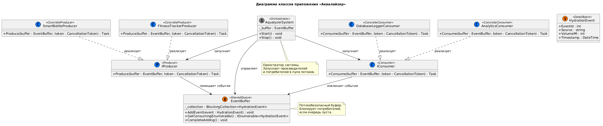
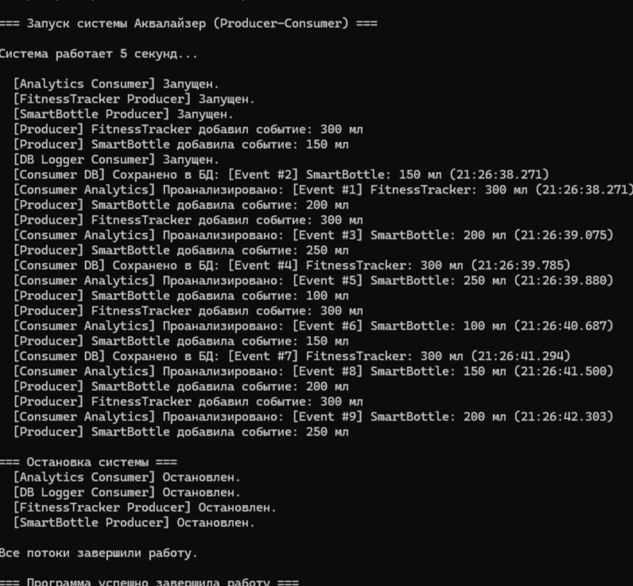

# Министерство науки и высшего образования Российской Федерации

**Федеральное государственное автономное образовательное учреждение высшего образования**  
«СЕВЕРО-КАВКАЗСКИЙ ФЕДЕРАЛЬНЫЙ УНИВЕРСИТЕТ»

**Институт информационных технологий и кибербезопасности**  
**Межинститутская базовая кафедра**

**Дисциплина:** Паттерны проектирования

## ОТЧЕТ ПО ЛАБОРАТОРНОЙ РАБОТЕ №15

**Тема:** Идиоматические паттерны: Producer-Consumer

| | |
| :--- | :--- |
| **Выполнил:** | Мусхажиев Игорь Александрович 4 курс, группа ПИЖ-б-о-23-2(2) 09.03.04 «Программная инженерия», очная форма обучения _____________________________ (подпись) |
| **Проверил:** | ассистент МБК ИИТиКБ Белик А. И. _____________________________ (подпись) |

**Отчет защищен с оценкой:** ___________  
**Дата защиты:** __________________

**Ставрополь, 2026 г.**

---

### Цель работы
Получить практические навыки применения идиоматических паттернов многопоточного и асинхронного программирования для организации безопасного обмена данными между потоками и повышения отзывчивости приложения на языке программирования высокого уровня.

## 1. Теоретическое обоснование
Producer-Consumer (Производитель-Потребитель) — это классический идиоматический паттерн многопоточного программирования, который решает проблему безопасного обмена данными между потоками. Он разделяет процесс генерации данных (Producer) и процесс их обработки (Consumer) с помощью общей потокобезопасной очереди (буфера).

## 2. Проектирование и реализация

**Вариант 7:** Разработка приложения «Аквалайзер».

**Постановка задачи:**  Реализовать систему асинхронной обработки событий гидратации, поступающих от различных источников (IoT-устройства, ручной ввод), с использованием паттерна Producer-Consumer (Производитель-Потребитель) и пула потоков (Thread Pool) для фоновой обработки данных.

### 2.1. Диаграмма классов (UML)

Реализация паттернов подтверждается следующей диаграммой классов в нотации UML:

> *Рисунок 1 – Диаграмма классов*
> 

### 2.2. Исходный код

Полный исходный код также доступен в репозитории GitHub: [https://github.com/Igoremys/Aqualyzer.git](https://github.com/Igoremys/Aqualyzer.git)

> *Рисунок 2 – Результат работы программы*
> 

## Вывод

В ходе выполнения лабораторной работы № 15 было разработано приложение «Аквалайзер» (Вариант 7) на языке C# с применением идиоматического паттерна многопоточного программирования Producer-Consumer (Производитель-Потребитель).
В рамках работы были решены следующие задачи:
Разделение ответственности: процесс генерации событий гидратации (от «умной бутылки» и фитнес-трекера) полностью отделен от процесса их обработки (логирование в БД и аналитика). Производители и потребители не имеют прямых ссылок друг на друга.
Потокобезопасность: использование BlockingCollection<T> позволило избежать ручного управления блокировками (lock, Monitor). Буфер автоматически блокирует потребителей при отсутствии данных и производителей при переполнении очереди (ограниченная емкость boundedCapacity: 5).
Использование пула потоков (Thread Pool): запуск задач через Task.Run() позволил эффективно использовать потоки из пула CLR, избегая накладных расходов на создание и уничтожение потоков вручную.
Корректное завершение: применение CancellationToken и метода CompleteAdding() обеспечило graceful shutdown (грациозное завершение) всех потоков без потери данных и возникновения взаимных блокировок (deadlocks).