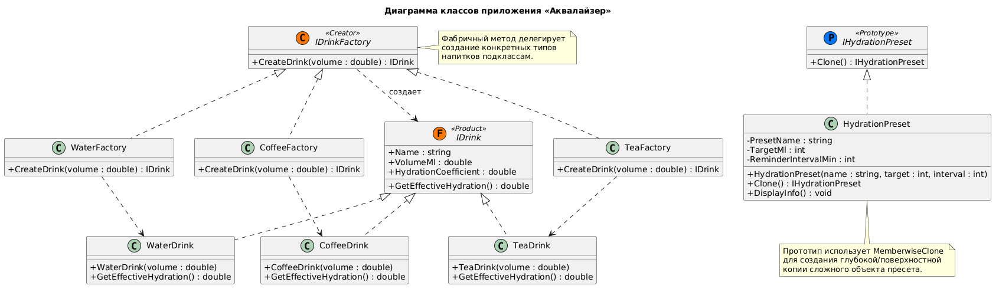
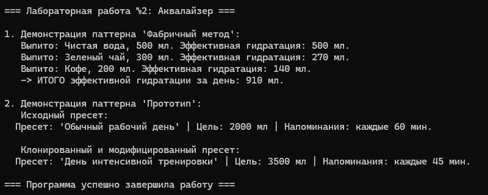

# Министерство науки и высшего образования Российской Федерации

**Федеральное государственное автономное образовательное учреждение высшего образования**  
«СЕВЕРО-КАВКАЗСКИЙ ФЕДЕРАЛЬНЫЙ УНИВЕРСИТЕТ»

**Институт информационных технологий и кибербезопасности**  
**Межинститутская базовая кафедра**

**Дисциплина:** Паттерны проектирования

## ОТЧЕТ ПО ЛАБОРАТОРНОЙ РАБОТЕ №2

**Тема:** Порождающие паттерны: Абстрактная фабрика, Фабричный метод, Прототип

| | |
| :--- | :--- |
| **Выполнил:** | Мусхажиев Игорь Александрович 4 курс, группа ПИЖ-б-о-23-2(2) 09.03.04 «Программная инженерия», очная форма обучения _____________________________ (подпись) |
| **Проверил:** | ассистент МБК ИИТиКБ Белик А. И. _____________________________ (подпись) |

**Отчет защищен с оценкой:** ___________  
**Дата защиты:** __________________

**Ставрополь, 2026 г.**

---

### Цель работы
Получить практические навыки применения порождающих паттернов проектирования для создания семейств объектов и клонирования сложных структур на языке программирования высокого уровня.

## 1. Теоретическое обоснование

В данной работе применены два порождающих паттерна:

*  Фабричный метод (Factory Method) – определяет интерфейс для создания объекта, но оставляет подклассам решение о том, какой класс инстанцировать. В «Аквалайзере» этот паттерн используется для создания объектов разных напитков (Water, Tea, Coffee). Каждый напиток имеет свой коэффициент гидратации, и фабрика инкапсулирует логику их создания, избавляя клиентский код от прямых вызовов конструкторов (new).
*   Прототип (Prototype) – позволяет копировать существующие объекты без привязки к их конкретным классам. В приложении этот паттерн реализован для клонирования объектов HydrationPreset (пресетов гидратации). Это позволяет пользователю быстро создать новый план (например, «День тренировки») на основе существующего («Обычный день»), изменив лишь несколько параметров, вместо настройки всех полей с нуля.

## 2. Проектирование и реализация

**Вариант 7:** Разработка приложения «Аквалайзер».

**Постановка задачи:** Расширить функционал приложения для учета различных типов напитков и управления шаблонами целей, с обязательным использованием паттернов «Фабричный метод» и «Прототип»

### 2.1. Диаграмма классов (UML)

Реализация паттернов подтверждается следующей диаграммой классов в нотации UML:

> *Рисунок 1 – Диаграмма классов*
> 

### 2.2. Исходный код

Полный исходный код  доступен в репозитории GitHub: [https://github.com/Igoremys/Aqualyzer.git](https://github.com/Igoremys/Aqualyzer.git)

> *Рисунок 2 – Результат работы программы*
> 

## Вывод

В ходе выполнения лабораторной работы № 2 была успешно расширена функциональность приложения «Аквалайзер» (Вариант 7) на языке C# с применением двух порождающих паттернов проектирования:
Фабричный метод (Factory Method) позволил инкапсулировать логику создания различных типов напитков (Water, Tea, Coffee). Это сделало код гибким: добавление нового типа напитка (например, Juice) потребует лишь создания нового класса продукта и новой фабрики, без изменения клиентского кода (соблюдение принципа Open/Closed).
Прототип (Prototype) с использованием метода MemberwiseClone() обеспечил эффективное клонирование сложных объектов настроек (HydrationPreset). Это избавило от необходимости писать громоздкие конструкторы с множеством параметров для создания вариаций базовых пресетов.

