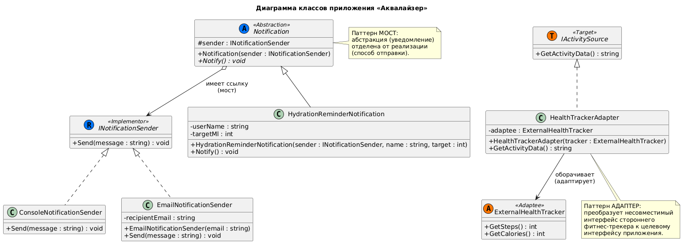
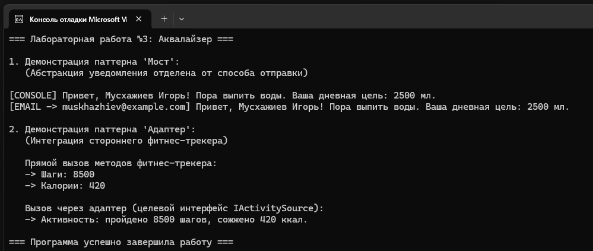

# Министерство науки и высшего образования Российской Федерации

**Федеральное государственное автономное образовательное учреждение высшего образования**  
«СЕВЕРО-КАВКАЗСКИЙ ФЕДЕРАЛЬНЫЙ УНИВЕРСИТЕТ»

**Институт информационных технологий и кибербезопасности**  
**Межинститутская базовая кафедра**

**Дисциплина:** Паттерны проектирования

## ОТЧЕТ ПО ЛАБОРАТОРНОЙ РАБОТЕ №3

**Тема:** Структурные паттерны: адаптер, мост

| | |
| :--- | :--- |
| **Выполнил:** | Мусхажиев Игорь Александрович 4 курс, группа ПИЖ-б-о-23-2(2) 09.03.04 «Программная инженерия», очная форма обучения _____________________________ (подпись) |
| **Проверил:** | ассистент МБК ИИТиКБ Белик А. И. _____________________________ (подпись) |

**Отчет защищен с оценкой:** ___________  
**Дата защиты:** __________________

**Ставрополь, 2026 г.**

---

### Цель работы
Получить практические навыки применения структурных паттернов проектирования для организации гибких и расширяемых классовых структур на языке программирования высокого уровня.

## 1. Теоретическое обоснование

В данной работе применены два структурных паттерна:

*   Мост (Bridge) – разделяет один большой класс или набор тесно связанных классов на две отдельные иерархии: «абстракцию» и «реализацию», которые можно изменять независимо. В «Аквалайзере» этот паттерн используется для разделения логики уведомлений о необходимости попить воды (абстракция — HydrationReminderNotification) от способа их доставки (реализация — INotificationSender с конкретными реализациями ConsoleNotificationSender, EmailNotificationSender). Это позволяет добавлять новые каналы отправки, не трогая код уведомлений, и наоборот.
*   Адаптер (Adapter) – позволяет объектам с несовместимыми интерфейсами работать вместе. В приложении этот паттерн реализован для интеграции стороннего фитнес-трекера ExternalHealthTracker, который отдает данные в формате GetSteps() / GetCalories(), с внутренним интерфейсом приложения IActivitySource, требующим метод GetActivityData(). Класс-адаптер HealthTrackerAdapter преобразует вызовы одного интерфейса в вызовы другого.

## 2. Проектирование и реализация

**Вариант 7:** Разработка приложения «Аквалайзер».

**Постановка задачи:** Расширить функционал приложения для поддержки различных каналов уведомлений и интеграции со сторонними фитнес-сервисами, с обязательным использованием паттернов «Мост» (Bridge) и «Адаптер» (Adapter)

### 2.1. Диаграмма классов (UML)

Реализация паттернов подтверждается следующей диаграммой классов в нотации UML:

> *Рисунок 1 – Диаграмма классов*
> 

### 2.2. Исходный код

Полный исходный код доступен в репозитории GitHub: [https://github.com/Igoremys/Aqualyzer.git](https://github.com/Igoremys/Aqualyzer.git)

> *Рисунок 2 – Результат работы программы*
> 

## Вывод

В ходе выполнения лабораторной работы было расширено приложение «Аквалайзер» с применением двух структурных паттернов проектирования:
Мост (Bridge) позволил разделить абстракцию уведомления (HydrationReminderNotification) и реализацию способа его доставки (INotificationSender). Благодаря этому:
можно добавлять новые каналы отправки (например, Push-уведомления, SMS) без изменения кода самих уведомлений;
можно создавать новые виды уведомлений (о достижении цели, о обезвоживании), используя уже существующие каналы;
абстракция и реализация развиваются независимо друг от друга.
Адаптер (Adapter) обеспечил бесшовную интеграцию стороннего фитнес-трекера ExternalHealthTracker с несовместимым интерфейсом (GetSteps(), GetCalories()) во внутреннюю систему приложения через целевой интерфейс IActivitySource. Это позволило использовать внешние сервисы без модификации их кода и без нарушения внутренней архитектуры приложения.
