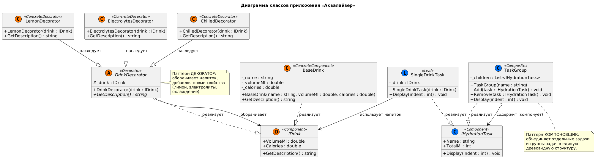
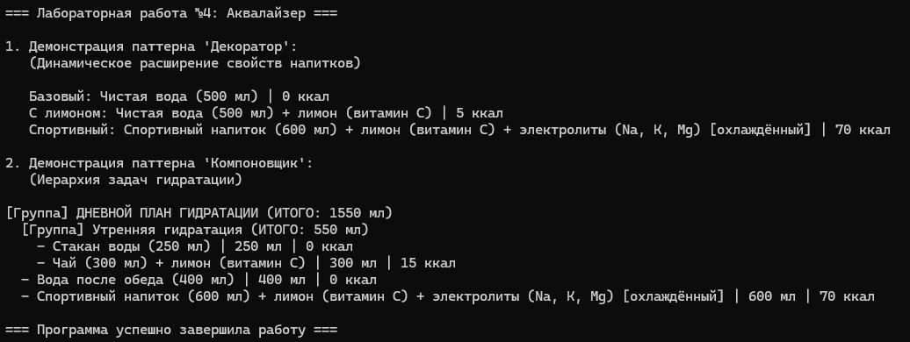

# Министерство науки и высшего образования Российской Федерации

**Федеральное государственное автономное образовательное учреждение высшего образования**  
«СЕВЕРО-КАВКАЗСКИЙ ФЕДЕРАЛЬНЫЙ УНИВЕРСИТЕТ»

**Институт информационных технологий и кибербезопасности**  
**Межинститутская базовая кафедра**

**Дисциплина:** Паттерны проектирования

## ОТЧЕТ ПО ЛАБОРАТОРНОЙ РАБОТЕ №4

**Тема:** Структурные паттерны: компоновщик, декоратор

| | |
| :--- | :--- |
| **Выполнил:** | Мусхажиев Игорь Александрович 4 курс, группа ПИЖ-б-о-23-2(2) 09.03.04 «Программная инженерия», очная форма обучения _____________________________ (подпись) |
| **Проверил:** | ассистент МБК ИИТиКБ Белик А. И. _____________________________ (подпись) |

**Отчет защищен с оценкой:** ___________  
**Дата защиты:** __________________

**Ставрополь, 2026 г.**

---

### Цель работы
Получить практические навыки применения структурных паттернов проектирования для построения гибких иерархических объектов и динамического расширения их функциональности на языке программирования высокого уровня.

## 1. Теоретическое обоснование

В данной работе применены два структурных паттерна:

*   Декоратор (Decorator) - динамически добавляет объекту новые обязанности. Это гибкая альтернатива порождению подклассов для расширения функциональности. В «Аквалайзере» этот паттерн применяется для оборачивания базового напитка (BaseDrink) в декораторы, добавляющие новые свойства: LemonDecorator (добавляет витамин C и калории), ElectrolytesDecorator (добавляет электролиты для спортсменов), ChilledDecorator (помечает напиток как охлаждённый). Это позволяет комбинировать свойства напитков в любом порядке без создания взрывного числа подклассов.
*  Компоновщик (Composite) - объединяет объекты в древовидную структуру для работы с ними как с единым целым. В приложении этот паттерн реализован для построения иерархии задач гидратации: SingleDrinkTask (лист - задача выпить один конкретный напиток) и TaskGroup (композиция - группа задач, например «Утренняя гидратация» или «Дневной план»). Клиентский код работает одинаково как с отдельными задачами, так и с их группами.

## 2. Проектирование и реализация

**Вариант 7:** Разработка приложения «Аквалайзер».

**Постановка задачи:** Расширить функционал приложения для поддержки составных задач гидратации и динамического расширения свойств напитков, с обязательным использованием паттернов «Компоновщик» (Composite) и «Декоратор» (Decorator) 

### 2.1. Диаграмма классов (UML)

Реализация паттернов подтверждается следующей диаграммой классов в нотации UML:

> *Рисунок 1 – Диаграмма классов*
> 

### 2.2. Исходный код

Полный исходный код доступен в репозитории GitHub: [https://github.com/Igoremys/Aqualyzer.git](https://github.com/Igoremys/Aqualyzer.git)

> *Рисунок 2 – Результат работы программы*
> 

## Вывод
В ходе выполнения лабораторной работы № 4 было расширено приложение «Аквалайзер» (Вариант 7) на языке C# с применением двух структурных паттернов проектирования:
Декоратор (Decorator) позволил динамически добавлять новые свойства напиткам (лимон, электролиты, охлаждение) без создания взрывного числа подклассов. Благодаря этому:
можно комбинировать свойства напитков в любом порядке (например, «вода + лимон + электролиты + охлаждённая»);
новые свойства добавляются простым созданием нового класса-декоратора без изменения существующего кода (соблюдение принципа Open/Closed);
декораторы можно вкладывать друг в друга, создавая сложные комбинации.
Компоновщик (Composite) обеспечил построение иерархической структуры задач гидратации, где отдельные задачи (SingleDrinkTask) и группы задач (TaskGroup) обрабатываются единообразно. Благодаря этому:
клиентский код работает одинаково как с отдельными напитками, так и с целыми группами;
можно легко строить сложные планы гидратации («Дневной план» → «Утренняя гидратация» → «Стакан воды»);
автоматический подсчёт общего объёма жидкости (TotalMl) работает рекурсивно для всей иерархии.
