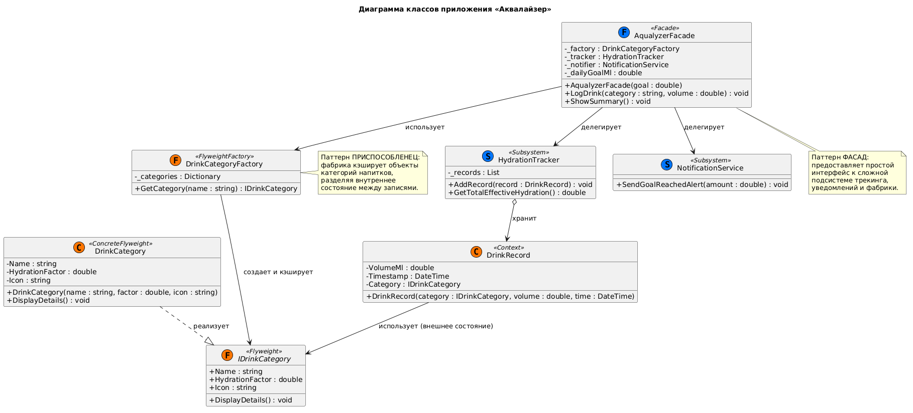
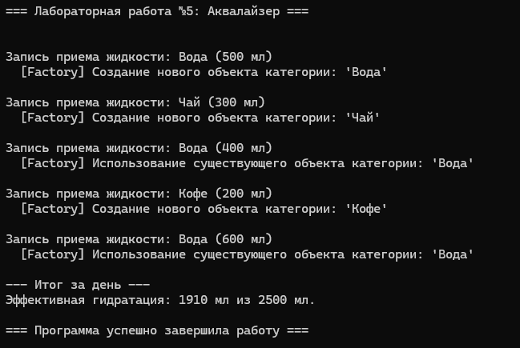

# Министерство науки и высшего образования Российской Федерации

**Федеральное государственное автономное образовательное учреждение высшего образования**  
«СЕВЕРО-КАВКАЗСКИЙ ФЕДЕРАЛЬНЫЙ УНИВЕРСИТЕТ»

**Институт информационных технологий и кибербезопасности**  
**Межинститутская базовая кафедра**

**Дисциплина:** Паттерны проектирования

## ОТЧЕТ ПО ЛАБОРАТОРНОЙ РАБОТЕ №5

**Тема:** Структурные паттерны: фасад, приспособленец

| | |
| :--- | :--- |
| **Выполнил:** | Мусхажиев Игорь Александрович 4 курс, группа ПИЖ-б-о-23-2(2) 09.03.04 «Программная инженерия», очная форма обучения _____________________________ (подпись) |
| **Проверил:** | ассистент МБК ИИТиКБ Белик А. И. _____________________________ (подпись) |

**Отчет защищен с оценкой:** ___________  
**Дата защиты:** __________________

**Ставрополь, 2026 г.**

---

### Цель работы
Получить практические навыки применения структурных паттернов проектирования для упрощения интерфейса сложных подсистем и оптимизации использования памяти за счет разделения состояния объектов на языке программирования высокого уровня.

## 1. Теоретическое обоснование

В данной работе применены два структурных паттерна:

*   Приспособленец (Flyweight) – позволяет вместить больше объектов в отведённую оперативную память за счёт разделения общего состояния между несколькими объектами. В «Аквалайзере» этот паттерн применяется для категорий напитков (DrinkCategory). Вместо того чтобы хранить название, коэффициент гидратации и иконку для каждой отдельной записи о выпитом стакане воды, эти данные (внутреннее состояние) выносятся в общие объекты, которые создаются один раз и кэшируются в DrinkCategoryFactory. Внешнее состояние (объём и время приёма) хранится в объекте DrinkRecord.
*   Фасад (Facade) – предоставляет унифицированный интерфейс к набору интерфейсов в подсистеме. В приложении этот паттерн реализован в классе AqualyzerFacade. Он скрывает от клиента сложную логику взаимодействия между фабрикой приспособленцев, трекером гидратации (HydrationTracker) и сервисом уведомлений (NotificationService), предоставляя простые методы LogDrink() и ShowSummary().

## 2. Проектирование и реализация

**Вариант 7:** Разработка приложения «Аквалайзер».

**Постановка задачи:** Расширить функционал приложения для эффективного хранения истории потребления напитков и упрощения клиентского API, с обязательным использованием паттернов «Фасад» (Facade) и «Приспособленец» (Flyweight)

### 2.1. Диаграмма классов (UML)

Реализация паттернов подтверждается следующей диаграммой классов в нотации UML:

> *Рисунок 1 – Диаграмма классов*
> 

### 2.2. Исходный код

Полный исходный код также доступен в репозитории GitHub: [https://github.com/Igoremys/Aqualyzer.git](https://github.com/Igoremys/Aqualyzer.git)

> *Рисунок 2 – Результат работы программы*
> 

## Вывод
В ходе выполнения лабораторной работы было расширено приложение «Аквалайзер» с применением двух структурных паттернов проектирования:
Приспособленец (Flyweight) позволил радикально сократить потребление памяти при хранении истории напитков. Благодаря фабрике DrinkCategoryFactory, объекты категорий напитков (с их внутренним состоянием: названием, коэффициентом, иконкой) создаются только один раз и переиспользуются для тысяч записей DrinkRecord. Это подтверждается выводом программы, где при повторном вызове LogDrink("Вода", ...) объект не создается заново, а берется из кэша.
Фасад (Facade) предоставил клиентскому коду простой и интуитивно понятный интерфейс (AqualyzerFacade). Клиенту больше не нужно вручную создавать фабрику, инициализировать трекер и сервис уведомлений — достаточно вызвать методы LogDrink() и ShowSummary(), что снижает связанность кода и упрощает его поддержку.

