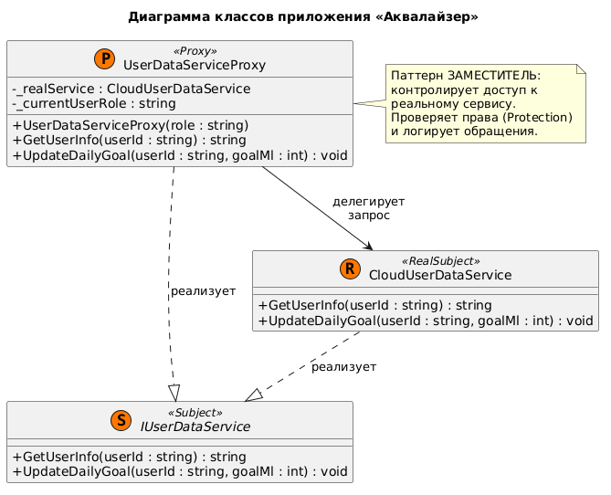
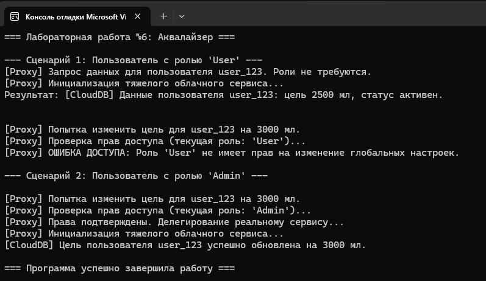

# Министерство науки и высшего образования Российской Федерации

**Федеральное государственное автономное образовательное учреждение высшего образования**  
«СЕВЕРО-КАВКАЗСКИЙ ФЕДЕРАЛЬНЫЙ УНИВЕРСИТЕТ»

**Институт информационных технологий и кибербезопасности**  
**Межинститутская базовая кафедра**

**Дисциплина:** Паттерны проектирования

## ОТЧЕТ ПО ЛАБОРАТОРНОЙ РАБОТЕ №6

**Тема:** Структурные паттерны: заместитель

| | |
| :--- | :--- |
| **Выполнил:** | Мусхажиев Игорь Александрович 4 курс, группа ПИЖ-б-о-23-2(2) 09.03.04 «Программная инженерия», очная форма обучения _____________________________ (подпись) |
| **Проверил:** | ассистент МБК ИИТиКБ Белик А. И. _____________________________ (подпись) |

**Отчет защищен с оценкой:** ___________  
**Дата защиты:** __________________

**Ставрополь, 2026 г.**

---

### Цель работы
Получить практические навыки применения структурного паттерна «Заместитель» (Proxy) для контроля доступа к объектам, логирования операций и оптимизации работы с ресурсоемкими сервисами на языке программирования высокого уровня.

## 1. Теоретическое обоснование
В данной работе применен паттерн Заместитель (Proxy) – структурный паттерн, который предоставляет объект-заменитель, который контролирует доступ к оригинальному объекту. Заместитель позволяет выполнить что-то до или после того, как запрос попадет к оригинальному объекту.
В приложении «Аквалайзер» паттерн применяется в двух аспектах:
Защищающий заместитель (Protection Proxy) – контролирует доступ к оригинальному объекту на основе прав пользователя. В коде это реализовано в методе UpdateDailyGoal(): заместитель проверяет роль пользователя (UserRole), и если он не является администратором, запрос блокируется.
Логирование и контроль ресурсоемких операций – оригинальный сервис CloudUserDataService имитирует медленную работу с облачной базой данных. Заместитель UserDataServiceProxy перехватывает вызовы, логирует их и делегирует выполнение реальному сервису только после успешной проверки прав.

## 2. Проектирование и реализация

**Вариант 7:** Разработка приложения «Аквалайзер».

**Постановка задачи:** Реализовать механизм безопасного и контролируемого доступа к сервису управления пользовательскими данными и настройками гидратации, с обязательным использованием паттерна «Заместитель» (Proxy)

### 2.1. Диаграмма классов (UML)

Реализация паттернов подтверждается следующей диаграммой классов в нотации UML:

> *Рисунок 1 – Диаграмма классов*
> 

### 2.2. Исходный код

Полный исходный код также доступен в репозитории GitHub: [https://github.com/Igoremys/Aqualyzer.git](https://github.com/Igoremys/Aqualyzer.git)

> *Рисунок 2 – Результат работы программы*
> 

## Вывод

В ходе выполнения лабораторной работы № 6 было расширено приложение «Аквалайзер» с применением структурного паттерна проектирования Заместитель (Proxy).
В рамках работы были решены следующие прикладные задачи:
Контроль доступа (Protection Proxy): Заместитель UserDataServiceProxy перехватывает запросы на изменение дневной нормы воды и проверяет роль пользователя. Это позволило защитить критически важные настройки от несанкционированного изменения без необходимости встраивания логики проверок непосредственно в код облачного сервиса.
Ленивая инициализация (Virtual Proxy): Реальный объект CloudUserDataService, имитирующий тяжелое облачное хранилище, создается только в момент первого реального обращения к нему. Это экономит ресурсы приложения при старте.
Прозрачность для клиента: Клиентский код работает исключительно через интерфейс IUserDataService и не знает, обращается он к реальному сервису или к его заместителю, что полностью соответствует принципу подстановки Лисков и снижает связанность системы.
