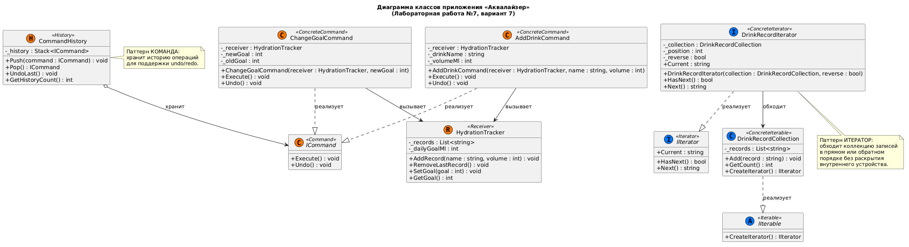
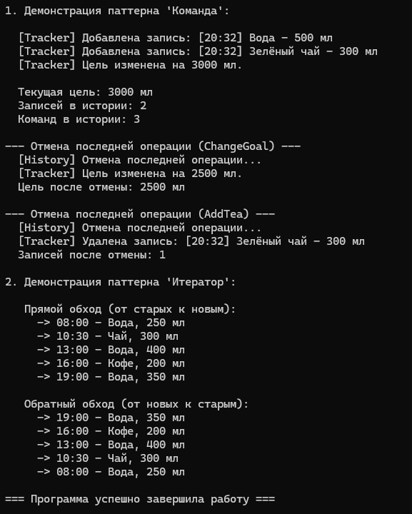

# Министерство науки и высшего образования Российской Федерации

**Федеральное государственное автономное образовательное учреждение высшего образования**  
«СЕВЕРО-КАВКАЗСКИЙ ФЕДЕРАЛЬНЫЙ УНИВЕРСИТЕТ»

**Институт информационных технологий и кибербезопасности**  
**Межинститутская базовая кафедра**

**Дисциплина:** Паттерны проектирования

## ОТЧЕТ ПО ЛАБОРАТОРНОЙ РАБОТЕ №7

**Тема:** Поведенческие паттерны: Команда, Итератор

| | |
| :--- | :--- |
| **Выполнил:** | Мусхажиев Игорь Александрович 4 курс, группа ПИЖ-б-о-23-2(2) 09.03.04 «Программная инженерия», очная форма обучения _____________________________ (подпись) |
| **Проверил:** | ассистент МБК ИИТиКБ Белик А. И. _____________________________ (подпись) |

**Отчет защищен с оценкой:** ___________  
**Дата защиты:** __________________

**Ставрополь, 2026 г.**

---

### Цель работы
Получить практические навыки применения поведенческих паттернов «Команда» и «Итератор» на языке C#.

## 1. Теоретическое обоснование
Команда (Command) – превращает запросы или простые операции в отдельные объекты. Это позволяет передавать запросы как аргументы методов, ставить их в очередь, логировать, а также поддерживать отмену операций. В «Аквалайзере» этот паттерн применяется для инкапсуляции операций над историей гидратации: AddDrinkCommand (добавить запись о напитке), RemoveDrinkCommand (удалить последнюю запись), ChangeGoalCommand (изменить дневную цель). Каждая команда знает, как выполнить действие (Execute()) и как откатить его (Undo()). Менеджер истории CommandHistory хранит стек выполненных команд, обеспечивая функционал undo/redo.
Итератор (Iterator) – позволяет последовательно обходить элементы составного объекта, не раскрывая его внутреннего представления. В приложении этот паттерн реализован для обхода коллекции записей DrinkRecordCollection. Создан собственный итератор DrinkRecordIterator, который поддерживает фильтрацию записей по дате и обход в обратном порядке (от самых свежих к старым), что удобно для отображения «последних действий пользователя».

## 2. Проектирование и реализация

**Вариант 7:** Разработка приложения «Аквалайзер».

**Постановка задачи:** Расширить функционал приложения для поддержки операций отмены/повтора действий пользователя и гибкого обхода истории потребления воды, с обязательным использованием паттернов «Команда» (Command) и «Итератор» (Iterator) в соответствии с методическими указаниями к лабораторной работе

### 2.1. Диаграмма классов (UML)

Реализация паттернов подтверждается следующей диаграммой классов в нотации UML:

> *Рисунок 1 – Диаграмма классов*
> 

### 2.2. Исходный код

Полный исходный код также доступен в репозитории GitHub: [https://github.com/Igoremys/Aqualyzer.git](https://github.com/Igoremys/Aqualyzer.git)

> *Рисунок 2 – Результат работы программы*
> 

## Вывод

В ходе выполнения лабораторной работы № 7 было расширено приложение «Аквалайзер» (Вариант 7) на языке C# с применением двух поведенческих паттернов проектирования:
Команда (Command) позволила инкапсулировать операции над историей гидратации в виде объектов. Благодаря этому:
реализован полноценный функционал отмены операций (undo) через стек CommandHistory — каждая команда знает, как выполнить действие (Execute()) и как откатить его (Undo());
клиентский код не зависит от конкретных операций — новые команды (например, ExportDataCommand, SendNotificationCommand) можно добавлять без изменения существующего кода;
команды можно логировать, сериализовать и передавать как аргументы, что открывает возможности для расширения (макросы, отложенное выполнение, очередь операций).
Итератор (Iterator) обеспечил гибкий и безопасный обход коллекции записей DrinkRecordCollection без раскрытия её внутреннего устройства (списка List<string>). Благодаря этому:
реализованы два вида итераторов — прямой (от старых записей к новым) и обратный (от новых к старым), что удобно для отображения «последних действий пользователя»;
клиентский код работает только через интерфейс IIterator и не зависит от конкретной реализации коллекции;
в будущем можно легко добавить итераторы с фильтрацией (например, только записи за сегодня, только определённый тип напитка) без изменения кода коллекции.