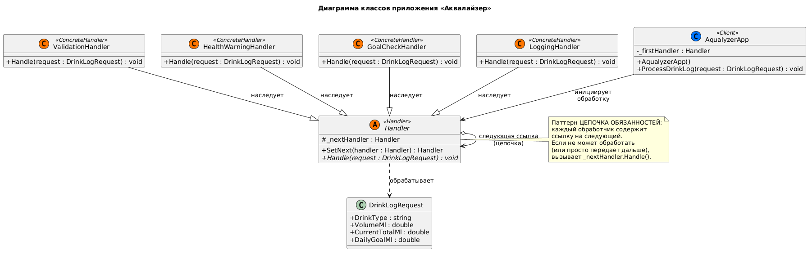
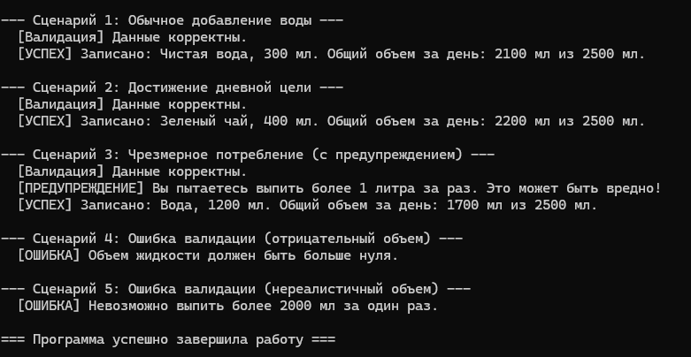

# Министерство науки и высшего образования Российской Федерации

**Федеральное государственное автономное образовательное учреждение высшего образования**  
«СЕВЕРО-КАВКАЗСКИЙ ФЕДЕРАЛЬНЫЙ УНИВЕРСИТЕТ»

**Институт информационных технологий и кибербезопасности**  
**Межинститутская базовая кафедра**

**Дисциплина:** Паттерны проектирования

## ОТЧЕТ ПО ЛАБОРАТОРНОЙ РАБОТЕ №8

**Тема:** Поведенческие паттерны: Цепочка обязанностей

| | |
| :--- | :--- |
| **Выполнил:** | Мусхажиев Игорь Александрович 4 курс, группа ПИЖ-б-о-23-2(2) 09.03.04 «Программная инженерия», очная форма обучения _____________________________ (подпись) |
| **Проверил:** | ассистент МБК ИИТиКБ Белик А. И. _____________________________ (подпись) |

**Отчет защищен с оценкой:** ___________  
**Дата защиты:** __________________

**Ставрополь, 2026 г.**

---

### Цель работы
Получить практические навыки применения поведенческого паттерна «Цепочка обязанностей» для организации гибкой и расширяемой последовательной обработки запросов на языке программирования высокого уровня.

## 1. Теоретическое обоснование
Цепочка обязанностей (Chain of Responsibility) – это поведенческий паттерн проектирования, который позволяет передавать запросы последовательно по цепочке обработчиков. Каждый последующий обработчик решает, может ли он обработать запрос сам, или должен передать его следующему звену.
В приложении «Аквалайзер» этот паттерн применяется для обработки события DrinkLogRequest (запрос на запись выпитого).

## 2. Проектирование и реализация

**Вариант 7:** Разработка приложения «Аквалайзер».

**Постановка задачи:** Реализовать механизм обработки запросов на добавление записей о потреблении жидкости, где каждый запрос последовательно проходит через несколько этапов проверки и обработки (валидация, предупреждения, проверка целей, логирование), с обязательным использованием паттерна «Цепочка обязанностей»

### 2.1. Диаграмма классов (UML)

Реализация паттернов подтверждается следующей диаграммой классов в нотации UML:

> *Рисунок 1 – Диаграмма классов*
> 

### 2.2. Исходный код

Полный исходный код также доступен в репозитории GitHub: [https://github.com/Igoremys/Aqualyzer.git](https://github.com/Igoremys/Aqualyzer.git)

> *Рисунок 2 – Результат работы программы*
> 

## Вывод

В рамках работы были решены следующие прикладные задачи:
Декомпозиция сложной логики: Вместо одного монолитного метода с множеством условий, логика обработки записи о напитке разделена на четыре независимых класса-обработчика.
Гибкость и расширяемость: Цепочку можно легко модифицировать. Например, чтобы добавить проверку на время последнего приема жидкости, достаточно создать новый класс TimeCheckHandler и встроить его в цепочку методом SetNext(), не изменяя код существующих обработчиков (соблюдение принципа Open/Closed).
Разделение ответственности: Каждый класс выполняет только одну задачу (валидация, предупреждение, проверка цели или логирование), что делает код чище, проще для тестирования и поддержки.