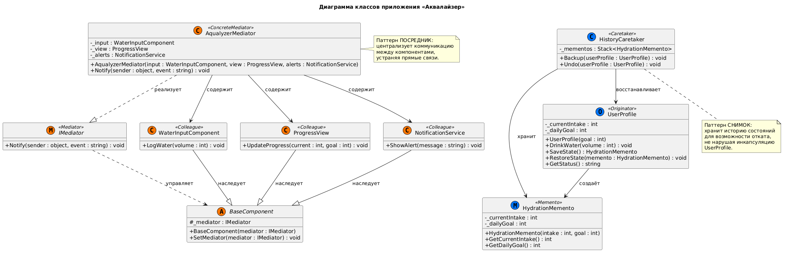
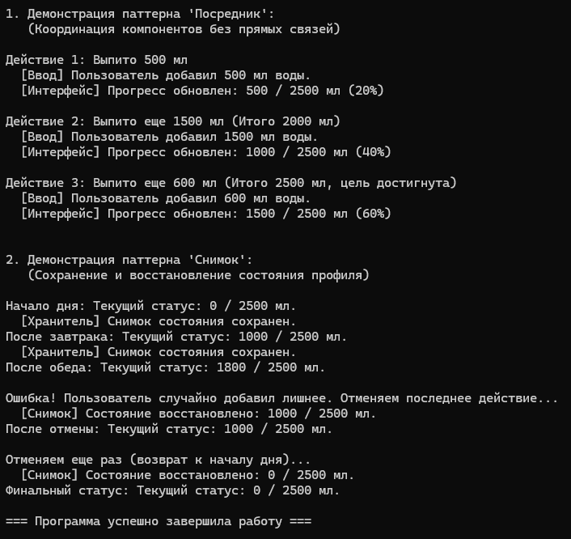

# Министерство науки и высшего образования Российской Федерации

**Федеральное государственное автономное образовательное учреждение высшего образования**  
«СЕВЕРО-КАВКАЗСКИЙ ФЕДЕРАЛЬНЫЙ УНИВЕРСИТЕТ»

**Институт информационных технологий и кибербезопасности**  
**Межинститутская базовая кафедра**

**Дисциплина:** Паттерны проектирования

## ОТЧЕТ ПО ЛАБОРАТОРНОЙ РАБОТЕ №9

**Тема:** Поведенческие паттерны: Посредник, Снимок

| | |
| :--- | :--- |
| **Выполнил:** | Мусхажиев Игорь Александрович 4 курс, группа ПИЖ-б-о-23-2(2) 09.03.04 «Программная инженерия», очная форма обучения _____________________________ (подпись) |
| **Проверил:** | ассистент МБК ИИТиКБ Белик А. И. _____________________________ (подпись) |

**Отчет защищен с оценкой:** ___________  
**Дата защиты:** __________________

**Ставрополь, 2026 г.**

---

### Цель работы
Получить практические навыки применения поведенческих паттернов проектирования для централизации сложного взаимодействия между объектами и сохранения состояния объектов без нарушения их инкапсуляции на языке программирования высокого уровня.

## 1. Теоретическое обоснование
В данной работе применены два поведенческих паттерна:
Посредник (Mediator) – уменьшает связанность множества классов между собой, заставляя их общаться друг с другом только через специальный объект-посредник. В «Аквалайзере» этот паттерн используется для координации компонентов: WaterInputComponent (ввод данных), ProgressView (отображение прогресса) и NotificationService (уведомления). Вместо того чтобы компоненты знали друг о друге, они отправляют события Mediator'у, который решает, как на них реагировать.
Снимок (Memento) – позволяет сохранять и восстанавливать предыдущие состояния объекта, не раскрывая деталей его реализации. В приложении паттерн реализуется через три роли: UserProfile (Инициатор/Originator), создающий снимки своего состояния; HydrationMemento (Снимок/Memento), хранящий состояние; и HistoryCaretaker (Хранитель/Caretaker), управляющий историей снимков для функции отмены действий.

## 2. Проектирование и реализация

**Вариант 7:** Разработка приложения «Аквалайзер».

**Постановка задачи:**  Реализовать механизм координации между компонентами приложения (интерфейс, аналитика, уведомления) и механизм сохранения/восстановления состояния профиля гидратации пользователя, с обязательным использованием паттернов «Посредник» и «Снимок»

### 2.1. Диаграмма классов (UML)

Реализация паттернов подтверждается следующей диаграммой классов в нотации UML:

> *Рисунок 1 – Диаграмма классов*
> 

### 2.2. Исходный код

Полный исходный код также доступен в репозитории GitHub: [https://github.com/Igoremys/Aqualyzer.git](https://github.com/Igoremys/Aqualyzer.git)

> *Рисунок 2 – Результат работы программы*
> 

## Вывод

В ходе выполнения лабораторной работы № 9 было расширено приложение «Аквалайзер» (Вариант 7) на языке C# с применением двух поведенческих паттернов проектирования:
Посредник (Mediator) позволил устранить прямые зависимости между компонентами ввода данных, отображения прогресса и сервисом уведомлений. Все коммуникации были централизованы в классе AqualyzerMediator. Это значительно упростило добавление новых компонентов (например, звукового сопровождения) без необходимости изменять код существующих классов, что соответствует принципу открытости/закрытости (Open/Closed Principle).
Снимок (Memento) обеспечил надежный механизм сохранения и восстановления состояния объекта UserProfile. Использование класса HistoryCaretaker и неизменяемого HydrationMemento гарантировало, что внутренняя структура профиля остается инкапсулированной, при этом пользователь получает удобный функционал отмены ошибочных действий (Undo).